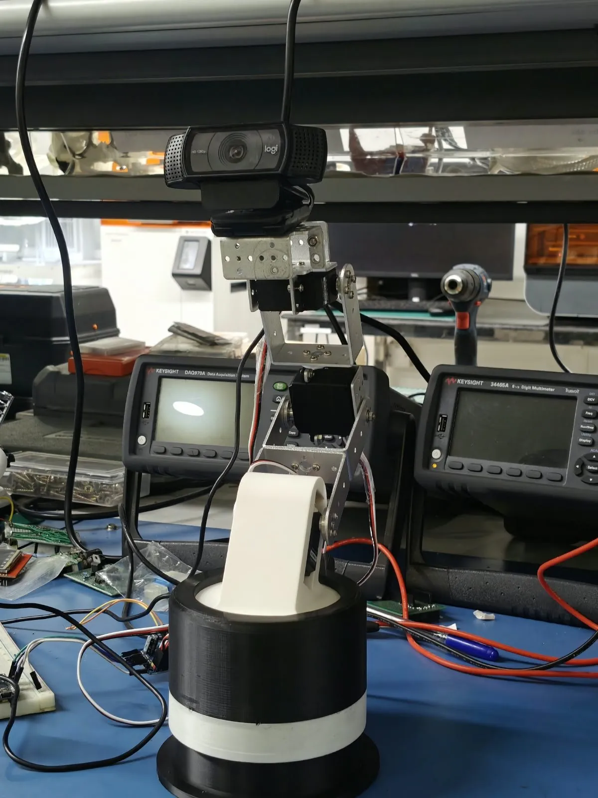

# Pranjal Singh Sesodia

Live at **https://pranjalsinghsesodia.github.io**. A plain static site: HTML, CSS and a little JavaScript, no build step.

**The idea.** The whole page is a player-piano roll. A player piano plays from punched paper: each hole is a note, its height picks the key, and its length is how long the key is held. The paper is the page's background, an 88-key keyboard runs down the left edge, and the holes drift toward it, so keys light as notes reach them. It carries a short, quiet waltz in D. The roll is sharp on the opening screen; once a visitor scrolls into the work it goes soft (out of focus) and quieter, so the content leads, and it comes back into focus, a little louder, while the cursor is near the keys. On a computer, visitors can punch notes (one click is one note), and each one plays once as it reaches the keys, then leaves the roll. On a phone the roll always stays soft and quiet, only the keys play, and a Sound switch sits in the top corner. Each section has its name on a vertical bar beside it, and on a matching tab by the keys; the tabs jump between sections. Photographs sit in watercolour washes. The site is always light, whatever the device's dark-mode setting.

---

## Making changes yourself

### Two ways to edit

**A. On GitHub, in the browser.** Best for quick text fixes.

1. Open https://github.com/pranjalsinghsesodia/pranjalsinghsesodia.github.io
2. Click the file (for example `index.html`), then the pencil icon (Edit).
3. Change the text, then click **Commit changes**.
4. The site updates by itself in a minute or two. The **Actions** tab shows it publishing.

**B. On your computer.** Best for images and bigger changes.

The folder `C:\test_portfolio\site` is linked to the GitHub repository.

1. Edit files with any editor. VS Code is the easiest.
2. Preview it locally, then open http://localhost:4322:
   ```bash
   python -m http.server 4322
   ```
   (Run that inside the `site` folder.)
3. Publish:
   ```bash
   git add -A
   git commit -m "Say what you changed"
   git push
   ```
   GitHub Desktop works too: *File → Add local repository →* choose the `site` folder, then *Commit* and *Push*.

If you edit on GitHub (A) and then on your computer (B), run `git pull` in the `site` folder first, so you start from the latest version.

Nothing is lost: every change is kept in the repository's history. On GitHub, open a file and click **History** to see or restore an older version.

### Where things are

| To change | Open | Look for |
|---|---|---|
| Your intro, the "Now / Before / Studying" panel | `index.html` | `<header class="hero">` near the top |
| Work cards (photo, label, title, one-liner) | `index.html` | `<ul class="cards">` |
| Smaller things | `index.html` | `<ul class="smalls">` |
| A section's short name (its vertical bar, and its tab by the keys) | that page | `<div class="mark" aria-hidden="true">` just above the section's heading |
| Photographs | `index.html` | `<div class="rows">` |
| About, coursework, tools | `index.html` | `<section class="sec" id="about">` |
| Email and contact text | every page | `<footer class="sec foot"` |
| A project's page | `work/<project>.html` | title, intro, facts, then sections |
| Your CV | `cv.pdf` | replace the file, keeping the name `cv.pdf` |
| Page titles and link previews | each page's `<head>` | `<title>`, `description`, `og:` lines, `media/og.jpg` |
| Colours and fonts | `css/site.css` | the `:root` block at the top |
| The music, volume and tempo, and how soft the roll gets | `js/roll.js` | `LEFT`, `RIGHT`, `MASTER`, `HUSH`, `TEMPO`, `QUIET`, `NEAR` near the top |

The quickest way to find anything is your editor's search (Ctrl+F) for a few words of the sentence you want to change.

### Text

Change the words between the tags and leave the tags alone. `<p>…</p>` is a paragraph, `<h2>…</h2>` a heading, `<li>…</li>` a list item, and `<a href="…">…</a>` a link. Special characters: write `&amp;` for &. Curly quotes (’ “ ”) are fine to type directly.

### A work card

Each project on the home page is one block like this:

```html
<li data-reveal><a class="card" href="work/surgical-arm.html">
  <span class="card-img"></span>
  <span class="meta small"><span class="tag">Robotics</span><span>mPragati, IIT Delhi</span><span>Since 2026</span></span>
  <h3>A surgical arm that finds its own joints with cameras</h3>
  <p>Two camera feedback loops for a 6-DOF arm whose servos can’t say where they are.</p>
</a></li>
```

- `href`: the project page it opens.
- `src`: the card's photo. `width` and `height` are that image's real size in pixels. `object-position` picks which part shows in the 4:3 crop: `50% 0%` is the top, `50% 100%` the bottom.
- The three `<span>`s in `meta`: the label (shown in brass), the place, and the years.
- `<h3>` is the title and `<p>` the one-liner.
- To reorder cards, move whole `<li>…</li>` blocks. Cards alternate left and right, and the right-hand column sits a little lower.

**Adding a project:**
1. Copy one of the pages in `work/` and rename it, for example `work/new-thing.html`.
2. Change its text and images.
3. Copy a card in `index.html` and point its `href` to the new page.
4. Fix the "Previous" and "Next" links at the bottom of the neighbouring project pages.

The tabs by the keyboard update themselves. A section's vertical name (on its bar and its tab) is the text in its `<div class="mark">`, for example `<div class="mark" aria-hidden="true">Work</div>`. Keep it short, a word or two.

### Images

- Put images in `media/work/<project>/`. WebP or JPG at about 1600 px wide and under about 300 KB keeps pages fast. Free converter: https://squoosh.app
- In the HTML, set `src`, `width`/`height` (the real pixel size) and an `alt` that says what the image shows.
- A figure on a project page looks like this:
  ```html
  <figure class="fig">
    
    <figcaption>Caption under the image.</figcaption>
  </figure>
  ```
- For two or three images side by side, copy a `<div class="jrow">` block. Each `<figure style="--ar:…">` there takes the image's width ÷ height.

### Photographs

Each photo is a `<button class="ph" …>` inside a `<div class="row">`. Keep one to three photos per row.

1. Save the photo twice as WebP in `media/photos/`: `name-900.webp` (900 px wide) and `name-1800.webp` (1800 px wide).
2. Copy an existing `<button class="ph">` block and change `name` everywhere in it.
3. Set `--ar` to width ÷ height (for example 0.75 for portrait 3:4, 1.7778 for 16:9), and `width`/`height` on the ``.
4. Fill in `data-title`, `data-date`, `data-camera` and `data-exp` (the exposure, for example `f/1.8 · 1/100 s · ISO 80`). These show in the line under the photographs and when a photo is enlarged.
5. The watercolour frame comes from `--m` (the mask, in `media/frames/`) and `--wash` (its colour). For a new photo you can reuse another photo's mask with a similar shape and pick a soft colour, or delete those settings for no frame.

### Site information

- **Email:** search all files for `pranjalsinghsesodia@gmail.com`.
- **LinkedIn and Instagram:** search for `linkedin.com` and `instagram.com`. Links to other sites open in a new tab because of `target="_blank" rel="noopener"`. Keep that on any new outside link.
- **CV:** replace `cv.pdf`.
- **Link previews** (what LinkedIn or WhatsApp show): the `og:` lines in each page's `<head>`, and the image `media/og.jpg` (1200 × 630).
- **"Last updated":** the last paragraph of the footer in `index.html`.

### The roll

The top of `js/roll.js`:

- `MASTER` is the volume. It's deliberately very low; 0.12 is a soft murmur even with speakers at full.
- `HUSH` is the volume while the roll is soft (when reading, and always on phones), as a share of `MASTER`. It's 0.35.
- `QUIET` is how strongly the soft roll shows below the opening screen: 0 hides it there, 1 is full strength. It's 0.5.
- `NEAR` is how close, in pixels from the keys, the cursor has to be for the roll to come fully into focus. It's 70.
- `TEMPO` is beats per second while it plays.
- `LEFT` and `RIGHT` are the waltz, as MIDI note numbers (60 is middle C, 62 is D).

Sound stays off until a visitor turns it on or clicks a key. Browsers only start sound after a click, tap or key press, so a remembered "on" waits for that.

---

## What's where

- `index.html`: the home page. `work/*.html`: one page per project.
- `css/site.css`: everything visual.
- `js/roll.js`: the roll, keyboard, octave tabs and sound.
- `js/site.js`: smooth scrolling (Lenis), entrances and reveals (GSAP), the photo readout, the lightbox.
- `media/`: images, video clips, photographs, frame masks, the portrait and `og.jpg`.
- `.github/workflows/deploy.yml`: publishes the folder to GitHub Pages on every push to `main`.

## Before publishing anything new

The elbow-implant images (mPragati) and operating-theatre footage (QuEST Lab) are deliberately left out until the labs clear them. Each spot is marked with a `CONFIDENTIALITY` comment in `work/elbow-and-knee.html` and `work/surgeon-motion.html`.
