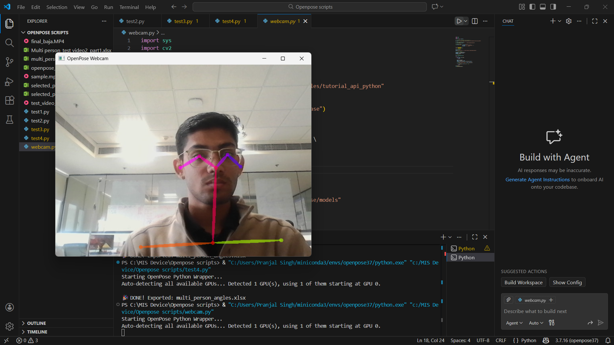
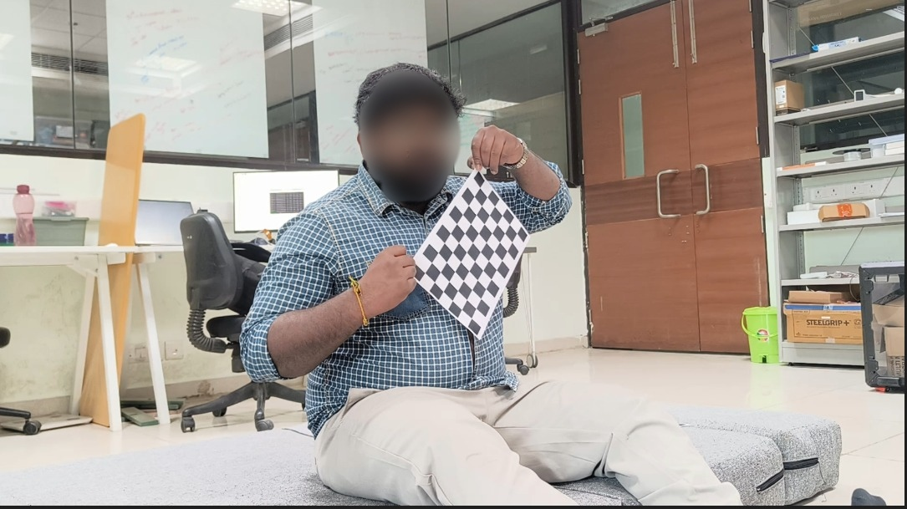
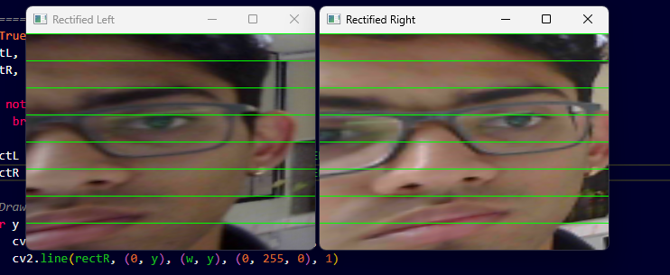
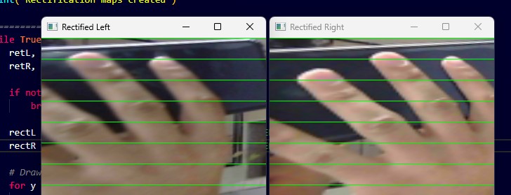
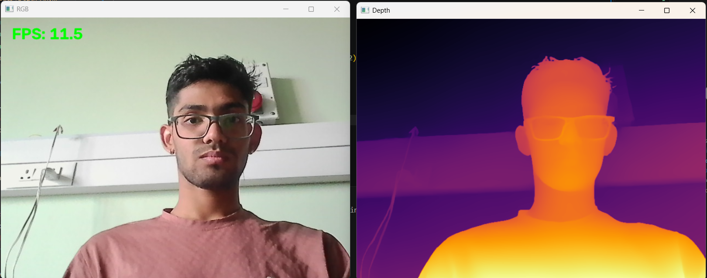

## Overview

At QuEST Lab, IIT Delhi, I built a pipeline that tracks people's pose and estimates depth from ordinary webcams, to understand how surgeons move without putting markers or sensors on them.

## The problem

Movement says a lot about technique and fatigue, but measuring it usually needs a motion-capture room or markers on the body. Neither works in an operating theatre. The question was how far cheap cameras and open-source models could go instead.

## Pose tracking and joint angles

I started with 2D pose estimation, first OpenPose and then AlphaPose, to find the joints of each person in the frame. From the keypoints the code calculates joint angles. When a limb is hidden behind another person or an instrument, it extrapolates the limb lines to keep the angle going through the occlusion.

<figure>

<figcaption>Pose and face keypoints on my own webcam, early in development.</figcaption>
</figure>
<figure>
<video controls muted playsinline preload="none" poster="../../media/depth-estimation/pose-early.jpg"><source src="../../media/depth-estimation/pose-early.mp4" type="video/mp4"></video>
<figcaption>Early pose detection, tracking my arms and hands.</figcaption>
</figure>

Before testing on surgical footage I recorded myself mimicking surgical movements. The surgical recordings themselves aren't published here.

## Calibration and triangulation

To get depth, I paired two webcams 7 cm apart and calibrated them with a checkerboard: each camera's intrinsics and lens distortion, then the pair's relative position. After rectification, the same point sits on the same row in both images, so its depth follows from how far it shifts between them.

<figure>

<figcaption>Calibration images for the stereo pair.</figcaption>
</figure>
<figure>
<video controls muted playsinline preload="none" poster="../../media/depth-estimation/triangulation-timelapse.jpg"><source src="../../media/depth-estimation/triangulation-timelapse.mp4" type="video/mp4"></video>
<figcaption>Timelapse: building and calibrating the two-camera rig.</figcaption>
</figure>

<figure>

<figcaption>Rectified left and right views. The green lines are shared rows.</figcaption>
</figure>
<figure>

<figcaption>The same check on a hand.</figcaption>
</figure>

Triangulated distances came out in metres and were **up to 95–96% accurate** in my tests.

## Depth maps and a tracked object

Alongside the stereo pair, I used Depth Anything to produce dense depth maps from a single camera in real time, at about 11 frames per second. To test depth on a specific object, I tracked a red pen cap and estimated its distance as it moved.

<figure>

<figcaption>Webcam feed and its live depth map.</figcaption>
</figure>

<figure>
<video controls muted playsinline preload="none" poster="../../media/depth-estimation/depth-pen-cap.jpg"><source src="../../media/depth-estimation/depth-pen-cap.mp4" type="video/mp4"></video>
<figcaption>Depth test: tracking a red pen cap.</figcaption>
</figure>

## How accurate can two webcams be?

For a rectified pair, depth is Z = f·B/d, where f is the focal length in pixels, B the distance between the cameras and d the disparity. An error of δd pixels in locating a point becomes a depth error of roughly

δZ ≈ Z² · δd / (f · B)

so the error grows with the square of the distance and shrinks with a wider baseline. At 7 cm apart, the cameras need to stay close to what they measure.

<figure>
<svg class="chart" viewBox="0 0 640 310" role="img" aria-labelledby="dz-t dz-d">
<title id="dz-t">Theoretical depth uncertainty against distance, 7 cm baseline</title>
<desc id="dz-d">Depth uncertainty grows with the square of distance. With 1 pixel of error it is about 3.8 mm at 0.6 m and 23 mm at 1.5 m. With 3 pixels it is about 11 mm at 0.6 m and 70 mm at 1.5 m.</desc>
<g class="grid">
<line x1="60" y1="195" x2="600" y2="195"/><line x1="60" y1="140" x2="600" y2="140"/><line x1="60" y1="85" x2="600" y2="85"/><line x1="60" y1="30" x2="600" y2="30"/>
</g>
<line class="axis" x1="60" y1="250" x2="600" y2="250"/>
<g text-anchor="end">
<text x="52" y="254">0</text><text x="52" y="199">20</text><text x="52" y="144">40</text><text x="52" y="89">60</text><text x="52" y="34">80 mm</text>
</g>
<g text-anchor="middle">
<text x="60" y="270">0.3</text><text x="195" y="270">0.6</text><text x="330" y="270">0.9</text><text x="465" y="270">1.2</text><text x="600" y="270">1.5 m</text>
<text x="330" y="296">Distance from the cameras, Z</text>
</g>
<polyline class="s2" points="60,242.2 127.5,232.6 195,219 262.5,201.6 330,180.3 397.5,155.1 465,126.1 532.5,93.3 600,56.4"/>
<polyline class="s1" points="60,247.4 127.5,244.2 195,239.7 262.5,233.9 330,226.8 397.5,218.4 465,208.7 532.5,197.7 600,185.5"/>
<g>
<circle class="d2" cx="195" cy="219" r="5"><title>3 px error at 0.6 m: 11.3 mm</title></circle>
<circle class="d2" cx="330" cy="180.3" r="5"><title>3 px error at 0.9 m: 25.4 mm</title></circle>
<circle class="d2" cx="465" cy="126.1" r="5"><title>3 px error at 1.2 m: 45.1 mm</title></circle>
<circle class="d2" cx="600" cy="56.4" r="5"><title>3 px error at 1.5 m: 70.4 mm</title></circle>
<circle class="d1" cx="195" cy="239.7" r="5"><title>1 px error at 0.6 m: 3.8 mm</title></circle>
<circle class="d1" cx="330" cy="226.8" r="5"><title>1 px error at 0.9 m: 8.4 mm</title></circle>
<circle class="d1" cx="465" cy="208.7" r="5"><title>1 px error at 1.2 m: 15.0 mm</title></circle>
<circle class="d1" cx="600" cy="185.5" r="5"><title>1 px error at 1.5 m: 23.5 mm</title></circle>
</g>
<text class="lab" x="588" y="46" text-anchor="end">3 px error</text>
<text class="lab" x="588" y="174" text-anchor="end">1 px</text>
<g transform="translate(76 24)">
<line class="s1 key" x1="0" y1="0" x2="18" y2="0"/><text x="24" y="4">1 px</text>
<line class="s2 key" x1="62" y1="0" x2="80" y2="0"/><text x="86" y="4">3 px</text>
</g>
</svg>
<figcaption>Theory, not measurement. Assumes a rectified pair of 1080p webcams 7 cm apart with f ≈ 1370 px (about 70° horizontal field of view).</figcaption>
</figure>

Show the values

| Z (m) | δZ at 1 px (mm) | δZ at 3 px (mm) |
| --- | --- | --- |
| 0.3 | 0.9 | 2.8 |
| 0.6 | 3.8 | 11.3 |
| 0.9 | 8.4 | 25.4 |
| 1.2 | 15.0 | 45.1 |
| 1.5 | 23.5 | 70.4 |

## Also at QuEST Lab

- A literature review on contactless, gamified ways to assess physical and cognitive fatigue in clinicians, and on optical depth sensing.
- In a four-person team, exploring and developing a pump and lining system for arthroscopic fluid management.

## What it led to

At mPragati the 6-DOF arm has the same problem in another form: its servos can't report where they are. The calibration and tracking I learned here is how I'm now giving it feedback.
