## Overview

Two mechanism problems from my internship at mPragati, IIT Delhi. One is a patented elbow implant being reviewed before technology transfer. The other is a polycentric four-bar prosthetic knee.

## Elbow implant: a review before technology transfer

- Modelled the implant and its test jig as SolidWorks parts and assemblies.
- Ran multi-body dynamics in ANSYS Mechanical to see how it actually moves.
- Found a flaw in the ulna-hinge trajectory that the original design had missed.
- I'm now leading the kinematic redesign.

<figure>

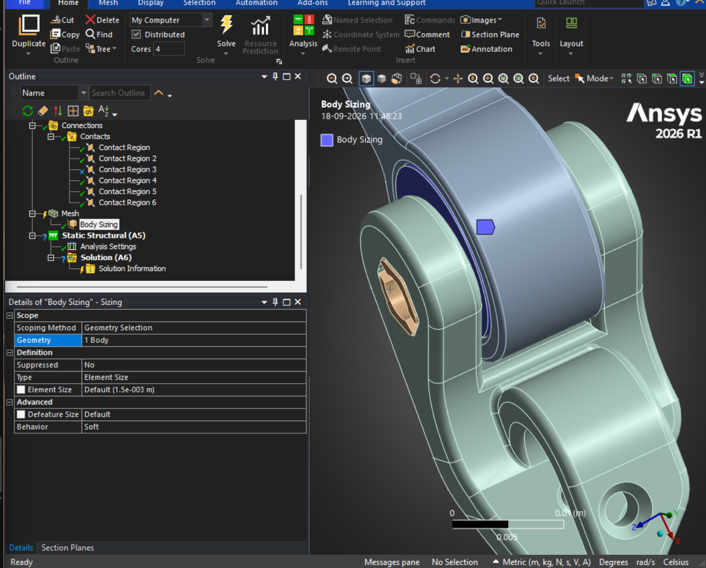

<figcaption>Setting up the mesh on the implant's hinge in ANSYS Mechanical.</figcaption>
</figure>
<figure>

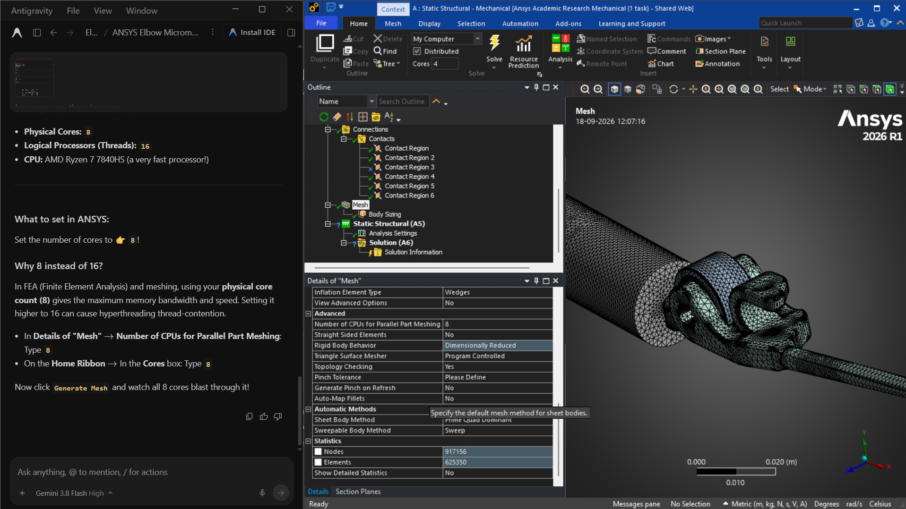

<figcaption>Meshed component, ready to solve.</figcaption>
</figure>

<figure>

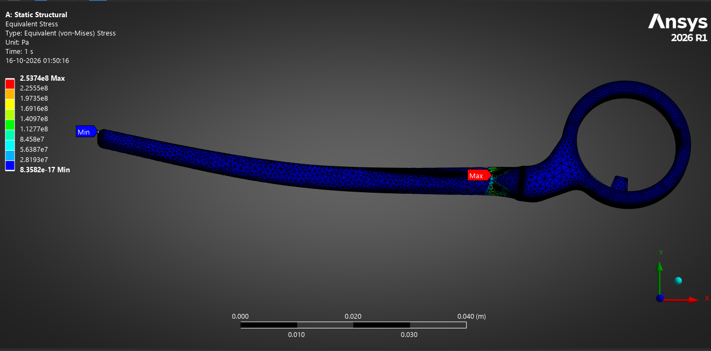

<figcaption>Static structural: equivalent (von Mises) stress along the ulna component.</figcaption>
</figure>

<figure>

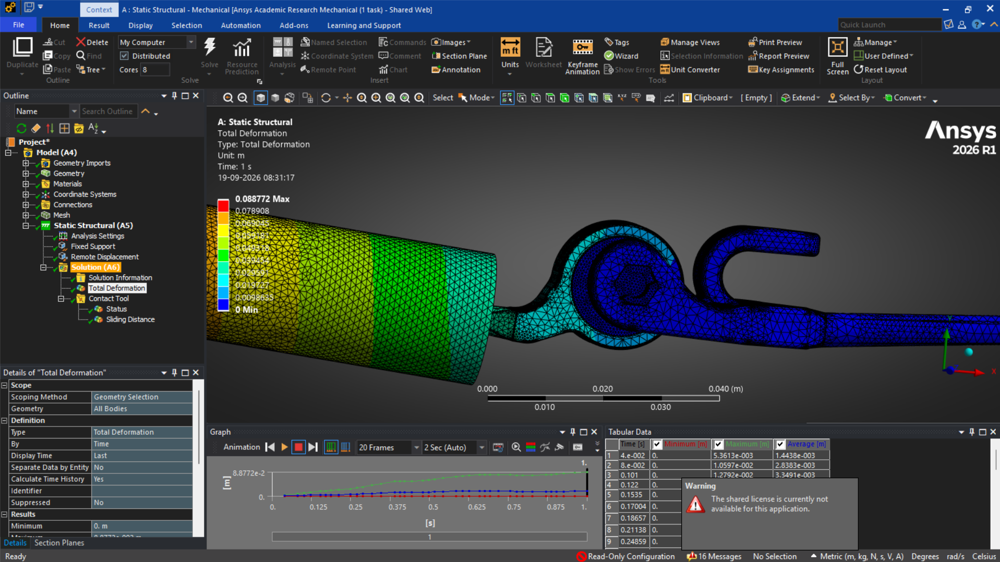

<figcaption>Total deformation of the assembly.</figcaption>
</figure>

<figure>

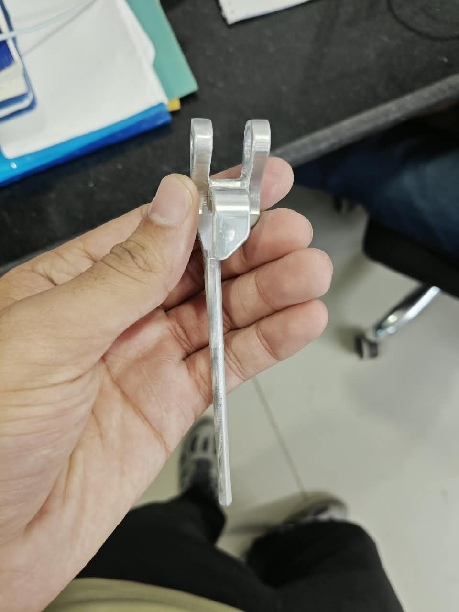

<figcaption>An aluminium stand-in for the ulna component.</figcaption>
</figure>
<figure>

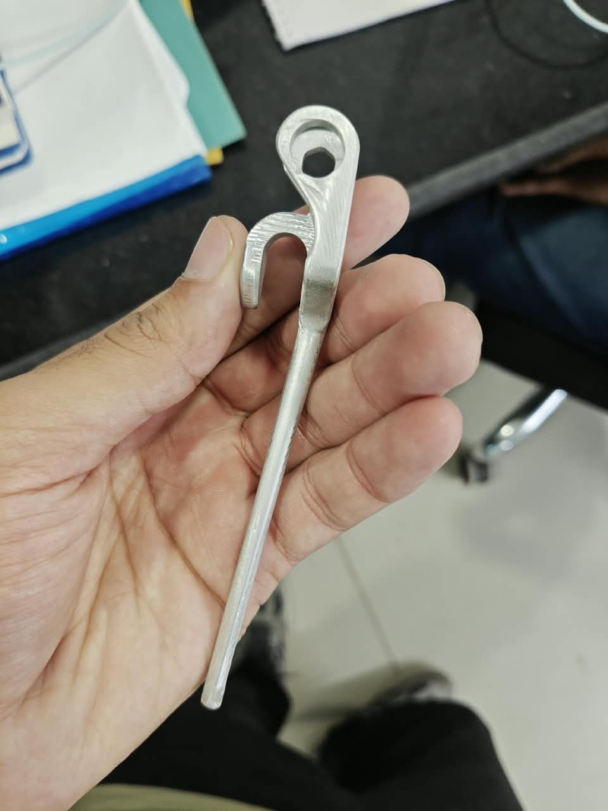

<figcaption>The hinge end of the same part.</figcaption>
</figure>

<figure>

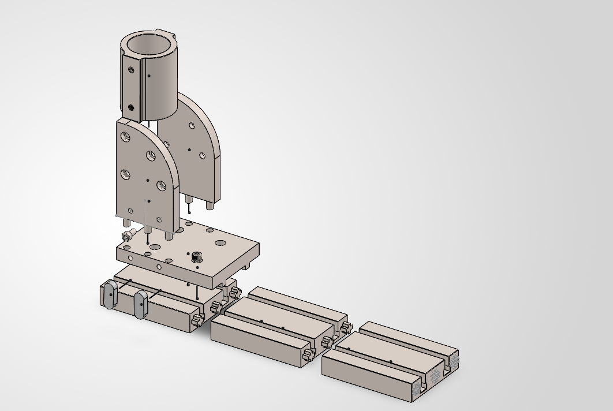

<figcaption>The test jig, modelled in SolidWorks.</figcaption>
</figure>

## Prosthetic knee: removing a kinematic lock

The polycentric four-bar knee jammed partway through its range. I redesigned the linkage in SolidWorks, as parts and as an assembly, to remove the locking. Then I printed it and validated it with physical motion tests.

<figure>

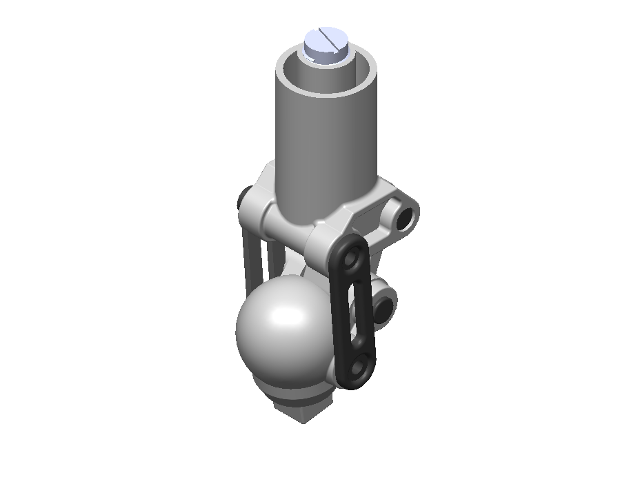

<figcaption>The knee unit in SolidWorks.</figcaption>
</figure>
<figure>

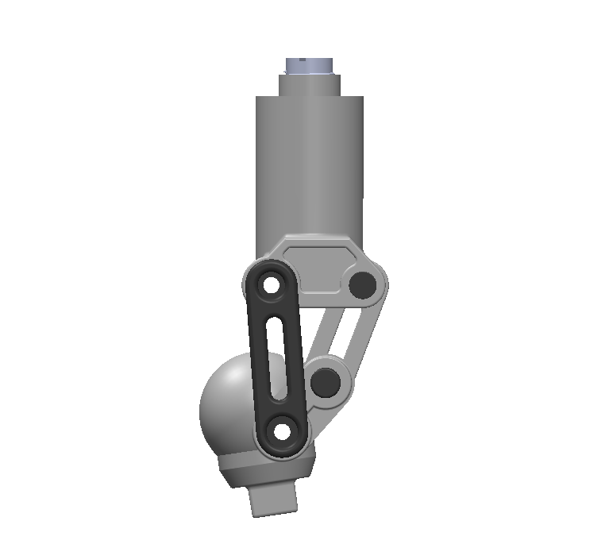

<figcaption>The four-bar linkage from the side.</figcaption>
</figure>

<figure>

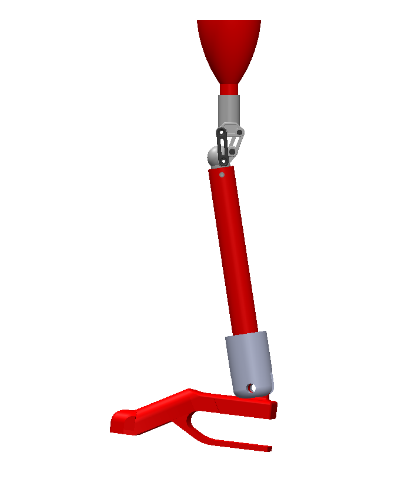

<figcaption>The knee in the full prosthetic leg assembly.</figcaption>
</figure>
<figure>

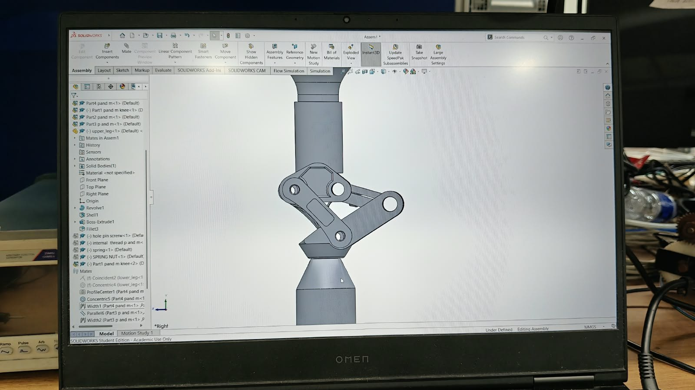

<figcaption>Working on the assembly.</figcaption>
</figure>

### From CAD to a printed part

<figure>

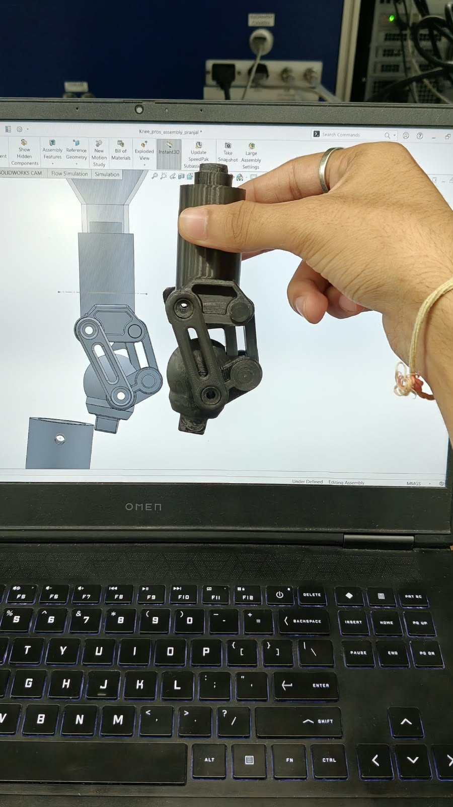

<figcaption>The printed knee next to its CAD model.</figcaption>
</figure>
<figure>

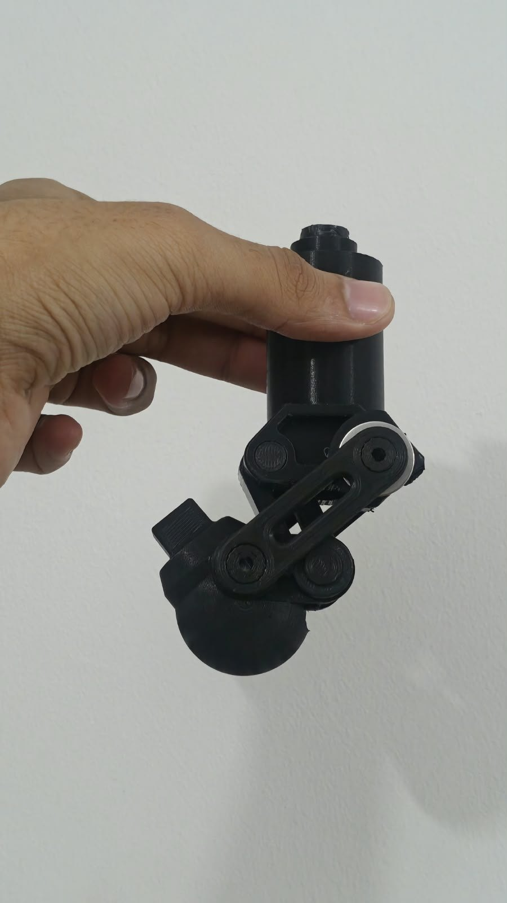

<figcaption>The printed linkage, flexed.</figcaption>
</figure>

<figure class="ph-fig">

<figcaption>Physical motion test.</figcaption></figure>

## What it taught me

Simulate before you trust a mechanism, even a patented one. Both problems were in the geometry, and both were visible in simulation before anything was cut.
