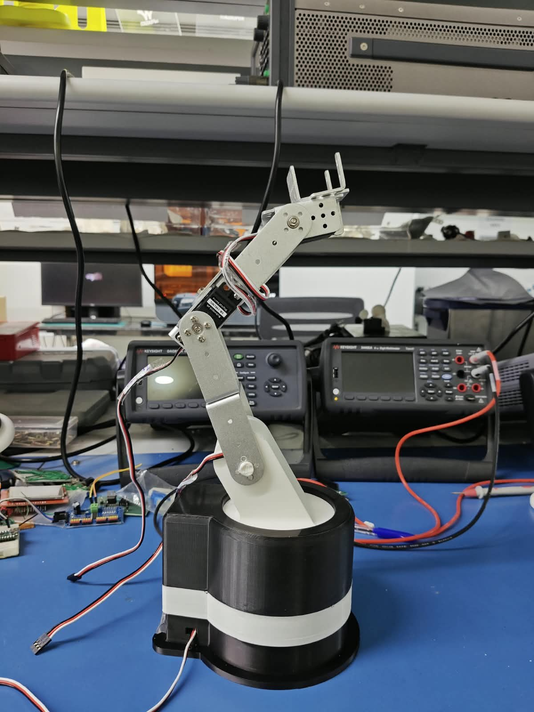
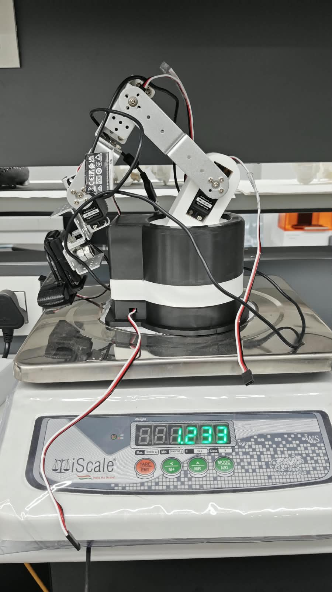
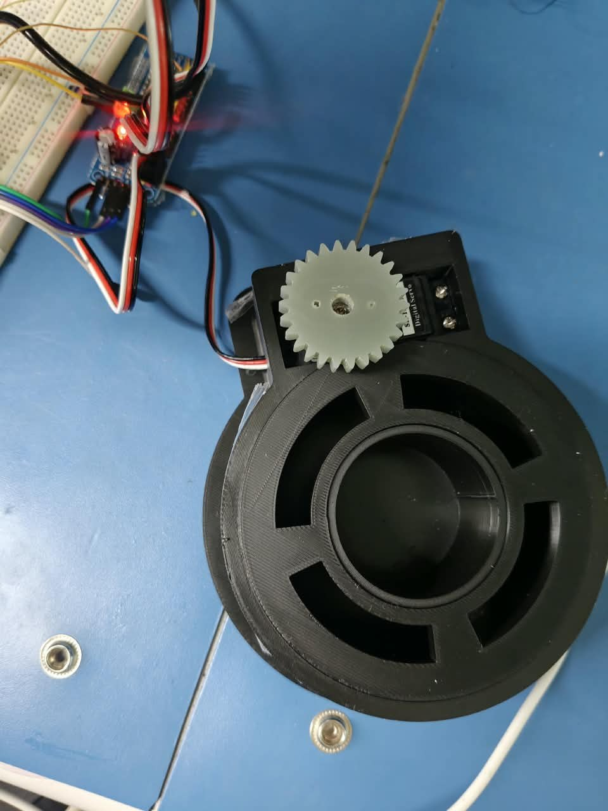
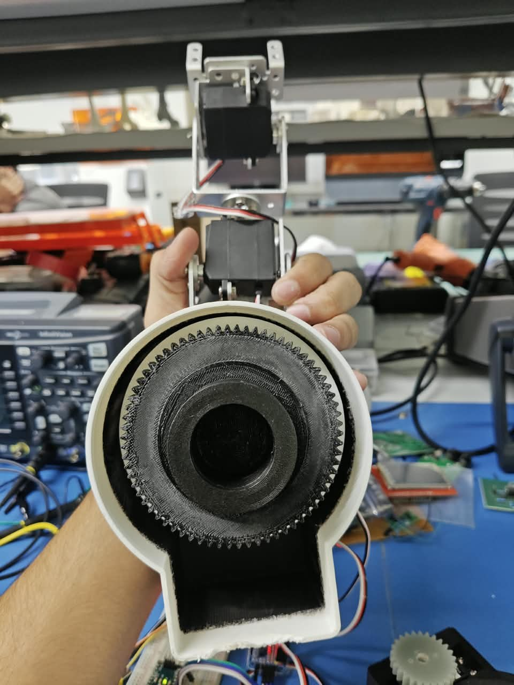
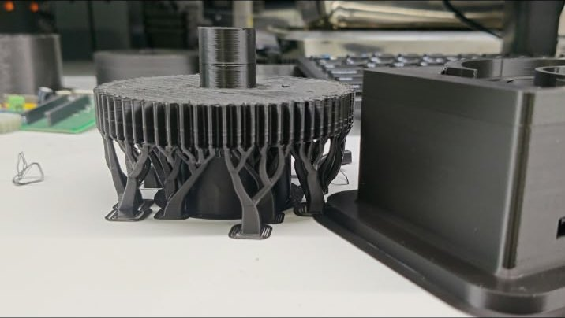

## Overview

A 6-DOF surgical-assistance arm and endoscope stabiliser, built at mPragati, IIT Delhi. The long-term aim is an arm that holds an endoscope steady and follows the surgeon's instrument.

## The problem

The prototype runs on digital servos. They're cheap and easy to replace, but they're open-loop: you command an angle and get no confirmation back. Under load or with backlash the arm drifts, and nothing in the hardware notices. For anything near a patient, that isn't acceptable.

## What I've built

- **The mechanical prototype.** Six servo-driven joints on aluminium brackets, standing on a 3D-printed base that turns on a servo-driven gear. With its servos and wiring, the arm weighs 1.233 kg.
- **Vision tracking.** Python and OpenCV code that follows a fingertip or the instrument tip, so the arm's position is measured by a camera instead of assumed.
- **A simulation setup.** The arm in ROS 2 and MuJoCo, so motions can be tried and broken in simulation before they run on hardware.

<figure>

<figcaption>Extended, on the bench at mPragati.</figcaption>
</figure>
<figure>

<figcaption>The complete arm on the scale: 1.233 kg.</figcaption>
</figure>

### The base

<figure>

<figcaption>The base from above: a servo-driven pinion sits beside the turntable.</figcaption>
</figure>
<figure>

<figcaption>Turned over: the printed ring gear inside the base.</figcaption>
</figure>

<figure>

<figcaption>A base part coming off the printer.</figcaption>
</figure>

<figure>
<video controls muted playsinline preload="none" poster="../../media/surgical-arm/arm-tracking-test.jpg"><source src="../../media/surgical-arm/arm-tracking-test.mp4" type="video/mp4"></video>
<figcaption>A test run of the arm with vision tracking at mPragati.</figcaption>
</figure>

<figure class="ph-fig">

<figcaption>The same arm in simulation.</figcaption></figure>

## How I'm testing it

Command a position, measure where the tool actually is with the camera, and close the gap. Simulation comes first, so a motion that fails can fail cheaply.

## What's next

- Stereo depth estimation, so tracking works in 3D instead of in the image plane. This builds directly on my [depth estimation work at QuEST Lab](../depth-estimation/).
- A mathematical model of the arm, then policy training in MATLAB.
